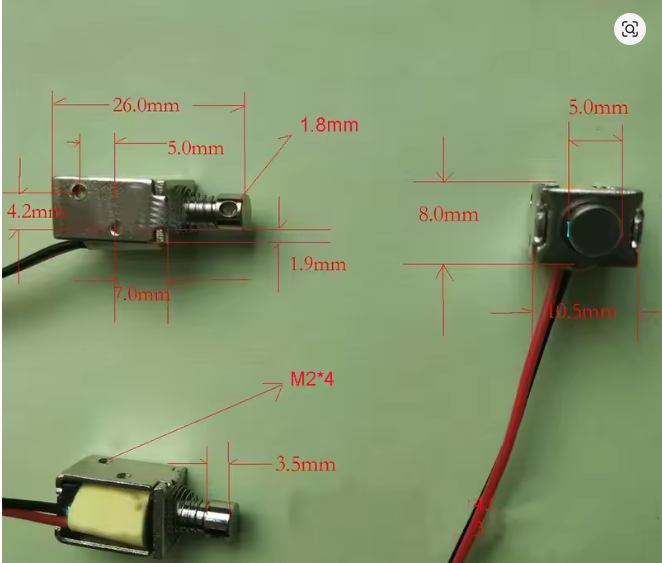
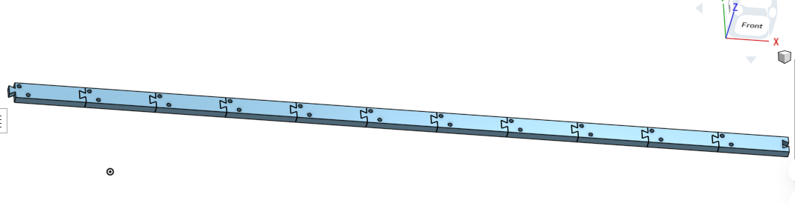
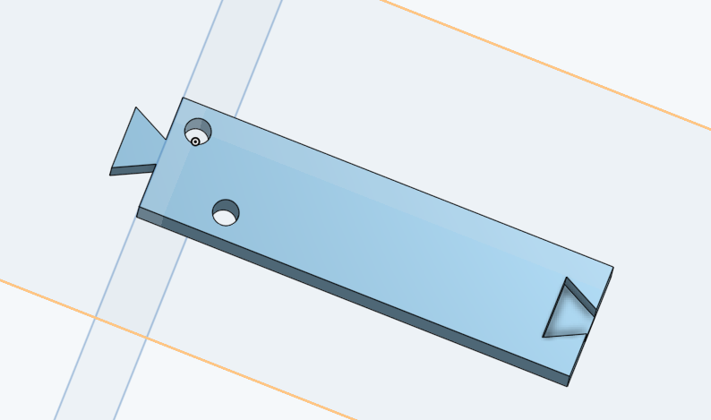

# Mornigong
A morning clock that wakes you up with a sound of a gong/marimba!

## How it works
This project uses 10 solenoids, a solenoid driver board (made by me), an esp32-c3 for controlling the solenoids, and a holder board (for my specific marimba and my solenoids)

Actual marimba and solenoids for my project

3d design of the driver board
## How to make it:
- 3d print 10 of the "part_studio.stl" files, and assemble them following "assembly.step"
- Fasten the solenoids to the 3d printed frame, and the frame to your marimba
- Wire the solenoids to the driver board
- Upload gong.ino to the esp32c3, and change the pins for your exact wiring.
- Play around!

### Print settings
- Use your preferred printer's basic settings (Like: https://craftlayerindia.com/blogs/3d-printer-settings/best-pla-settings-for-3d-printing)
- Leave supports off
- Infill: 15 %
- Print 10 of the parts, in batches or individually.
- Print in PLA

# IMPORTANT
- This is a two part project, I'm coming next week with the actual alarm clock, amd a more detailed program.

## BOM

| (Ref_no) | (Part name) | (Pcs) | (Link) | Price for needed parts/min order ($) |
| :--- | :--- | :--- | :--- | :--- |
| `-` | Solenoids | 10 | [AliExpress Link](https://aliexpress.com) | 15.00 |
| `-` | Marimba | 1 | [AliExpress Link](https://aliexpress.com) | 15.00 |
| `U1` | ESP32-C3 | 1 | [AliExpress Link](https://aliexpress.com?) | 3.00 |
| `C1` | 1000 uF 16V electrolytic, radial | 1 | [LCSC C43810](https://lcsc.com) | 0.80 |
| `C2, C3` | 100 nF 50V X7R, leaded MLCC | 2 | [LCSC C84772](https://lcsc.com) | 0.40 |
| `D1-D10` | 1N5408 rectifier, 3A 1000V, DO-201AD | 10 | [LCSC C2460](https://lcsc.com) | 0.85 |
| `F1` | PTC resettable fuse 3A hold / 6A trip, 30V | 1 | [LCSC C208487](https://lcsc.com) | 1.43 |
| `J1` | USB-C receptacle 16P, SMD + through-hole shell | 1 | [LCSC C165948](https://lcsc.com) | 0.87 |
| `J3-J12` | 2-position screw terminal, 5.0 mm pitch | 10 | [LCSC C474881](https://lcsc.com) | 1.03 |
| `Q10-Q19` | IRLZ44N logic-level MOSFET, TO-220AB | 10 | [LCSC C38774](https://lcsc.com) | 7.25 |
| `R1-R10` | 100 ohm 1/4W 5% carbon film, axial | 10 | [LCSC C120031](https://lcsc.com) | 0.59 |
| `R11-R20` | 10 kohm 1/4W 5% carbon film, axial | 10 | [LCSC C2894649](https://lcsc.com?) | 0.41 |
| `R21, R22` | 5.1 kohm 1/4W 5% carbon film, axial | 2 | [LCSC C120072](https://lcsc.com) | 0.57 |
| `-` | 3D printing costs | - | - | 2.50 |
| | | | **Összköltség (Total cost):** | **49.70 \$** |

